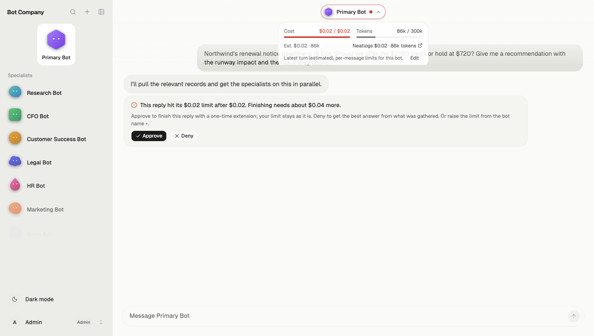
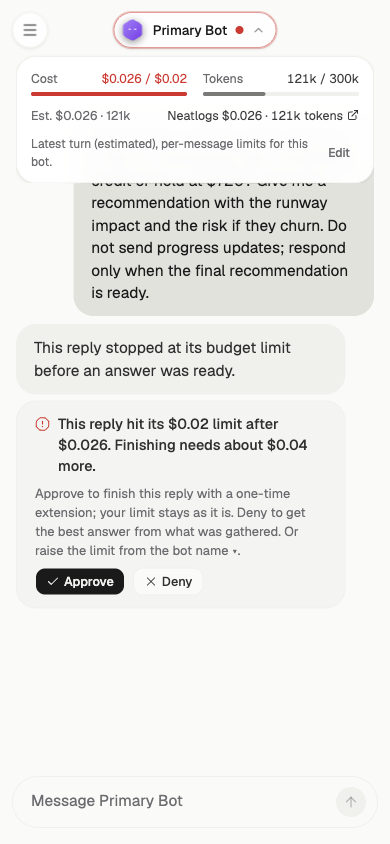
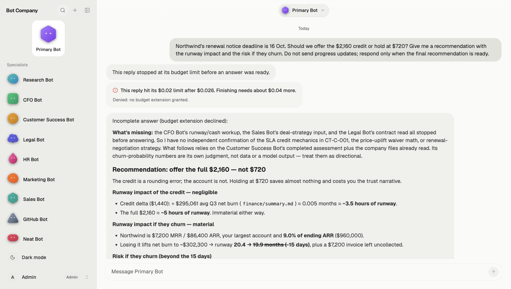

# Northwind: failure, recovery, and a trace-driven fix

Preserved screenshots with titles and provenance are in the
[12 October evidence index](evidence/2026-10-12/README.md).

## The task

Lumen Labs and Northwind Logistics are fictional demo companies. This run uses the
read-only records in `company/lumen-labs`, not live cfo.ai accounting data. No
customer credit, contract, or payment is changed by this question.

Ask the Primary Bot:

> Northwind's renewal notice deadline is 16 Oct. Should we offer the $2,160 credit or hold at $720? Give me a recommendation with the runway impact and the risk if they churn.

The decision joins finance, support, legal, and sales evidence. The agent chooses
which specialists to consult; the exact delegation order and cost vary by run.

## Recording sequence

1. Start a fresh Primary Bot chat. Open its usage/limits menu and set the cost cap
   to **$0.02**, leaving the token cap at **300,000**. Submit the question above.
2. Show the work and the eventual cap card. Explain that the limit is checked
   after model steps: the last step can overshoot $0.02. It is not a prepaid
   dollar ceiling or a daily spending limit.
3. Reload once to show that the pending decision survives. Click **Approve**.
   The server grants a one-time continuation budget and carries forward gathered
   specialist findings. Show the completed recommendation and the separate
   continuation cost. The saved per-message cap remains $0.02.
4. In a separate fresh run, click **Deny** instead. The agent gets one model step
   without tools and returns an answer marked **Incomplete**. This still incurs
   a small model cost; denial declines the extension, not every further token.
5. Open the capped run's Neatlogs link. Show the root error, model steps, repeated
   company reads, and token/cost totals. Then show an after trace and the table
   below. Do not claim that a cap event or custom attribute was inspected unless
   it is actually visible in the dashboard.
6. Show the prompt diff: the Primary Bot passes already-read figures and paths;
   delegated specialists read only missing evidence and return a compact brief.
   Show the Entire checkpoints on the implementation commits.
7. Reset the Primary Bot's limits to the defaults after recording.

For the Neat Bot, use the actual trace IDs from the run:

> Inspect traces 0ce0e491e0e1bdc3cf89d00ca4dfb65d and b0392391b4829a49a483b6c101ee336b. Compare failures, tokens, cost, and repeated company file reads. Explain what the traces support and what they do not establish. Do not change triage items or detections.

An admin can inspect the benchmark traces. An employee is restricted to their own
chat traces, so substitute that employee's actual run IDs when demonstrating with
a guest account.

## Evidence from three runs before and three after

Recorded 12 October 2026 with `deepseek/deepseek-flash`, a fresh Primary Bot thread
per run, and the default $0.25 / 300,000-token caps, on an isolated port-3001 copy
of the databases. Costs below are app estimates recovered from the saved SSE
streams. The machine-readable record is [northwind-benchmark.json](northwind-benchmark.json).

| Run | Cost (USD) | Tokens | Steps | Seconds | CFO file reads | Outcome |
|---|---:|---:|---:|---:|---:|---|
| Before 1 | 0.035506 | 179,824 | 11 | 109.7 | 7 | Completed |
| Before 2 | 0.058957 | 323,923 | 20 | 208.2 | 10 | Token capped |
| Before 3 | 0.051896 | 264,577 | 15 | 179.3 | 12 | Completed |
| After 1 | 0.031566 | 160,968 | 12 | 99.9 | 4 | Completed |
| After 2 | 0.049858 | 237,208 | 16 | 194.0 | 0 | Completed |
| After 3 | 0.060120 | 295,824 | 17 | 228.3 | 6 | Completed |

Across the three runs in each group:

- CFO file reads: **29 -> 10**, down 65.5%.
- CFO reply characters: **25,989 -> 6,730**, down 74.1%.
- Total tokens: **768,324 -> 694,000**, down 9.7%.
- Total estimated cost: **$0.146359 -> $0.141544**, down 3.3%.
- Completed within the default caps: **2/3 -> 3/3**.
- Total elapsed time: **497.2 -> 522.2 seconds**. No demonstrated latency gain.

This is a small observational sample. Routing and cache hits vary, one before
answer was truncated by its cap, and After 3 cost more than Before 3. It supports
reduced CFO reading and reply size, not a guaranteed per-run cost reduction or
guaranteed completion below the demo's much smaller $0.02 cap.

## Trace links

These links may require access to the matching Neatlogs project. Keep screenshots
in the submission alongside the links.

- [Before 2: token-capped run](https://app.neatlogs.com/traces/0ce0e491e0e1bdc3cf89d00ca4dfb65d?orgId=43303629-c7cb-4d5f-89c8-732d78cf1761&projectId=3fa20372-340e-40a3-bed9-841c1a90c3e3)
- [After 2: zero CFO file rereads](https://app.neatlogs.com/traces/b0392391b4829a49a483b6c101ee336b?orgId=43303629-c7cb-4d5f-89c8-732d78cf1761&projectId=3fa20372-340e-40a3-bed9-841c1a90c3e3)
- [Browser verification: capped turn](https://app.neatlogs.com/traces/444a39d312df7bd2220b074992c306f9?orgId=43303629-c7cb-4d5f-89c8-732d78cf1761&projectId=3fa20372-340e-40a3-bed9-841c1a90c3e3)
- [Browser verification: approved continuation](https://app.neatlogs.com/traces/c9c19ae1783c43f8ec075f82a8c653a5?orgId=43303629-c7cb-4d5f-89c8-732d78cf1761&projectId=3fa20372-340e-40a3-bed9-841c1a90c3e3)

After 1's trace (`af34fd5b5156a22e441921fbf1db7602`) returned "Trace not found"
when checked through MCP. Its local SSE evidence survives, but do not use that
dashboard trace as proof. Fresh status checks are saved in
[northwind-trace-verification.json](northwind-trace-verification.json).

## Answer checks

Check the recommendation against the records, not just whether the run finishes:

| Fact | Source / calculation |
|---|---|
| Customer request $2,160; finance credit $720; incremental concession $1,440 | `finance/summary.md`; `customer-success/zendesk-export/tickets.csv`, ZD-10431 |
| Northwind $7,200 MRR / $86,400 ARR, 9% of current MRR | `finance/stripe-export/customers.csv`; $7,200 / $80,000 |
| Cash $6,019,000; Q3 average monthly net burn $295,061; runway about 20.4 months | `finance/summary.md`; cash / burn |
| Extra concession costs about 0.00488 months / 0.146 days of runway | $1,440 / $295,061; 30-day month, constant burn |
| Churn with no cost savings gives about 19.91 months of runway | $6,019,000 / ($295,061 + $7,200) |
| Notice deadline 16 Oct; renewal 15 Dec 2026 | `legal/contracts-register.csv`, CT-C-001 |
| Failed invoice $7,200, four attempts, next retry 14 Oct | `finance/stripe-export/failed-payments.csv`, FP-2001 |
| Two open P1 ingestion tickets | `customer-success/zendesk-export/tickets.csv`, ZD-10482 and ZD-10497 |

All three after answers retained the core $720 / $2,160 / $1,440 and
$7,200 / $86,400 figures. After 1 and After 2 also included the approximately
19.9-month no-savings churn case. After 3 used a gross-margin-adjusted estimate
of about 20.1 months instead and omitted the exact renewal date. It also asserted
an unsupported ~$540k increase in the fundraising milestone gap: losing $86,400
ARR widens that ARR gap by $86,400, all else equal. Do not present that answer as
fully verified. Legal conclusions also require the signed agreement and a full
uptime history; a missing record does not prove that termination is invalid.

The demo should show a recommendation with explicit assumptions, source paths,
and unresolved facts. It must not claim that a real credit was issued or that
live cfo.ai data was retrieved in this local-data scenario.

## Persistence bug found during browser verification

A capped run can have no assistant text at all. Mastra drops a saved message with
empty `parts`, which also loses its escalation metadata. The fix stores a short
budget-stop explanation when no partial text exists, so the pending offer remains
available after reload.

The empty-reply regression was reproduced with the Northwind question plus
"Do not send progress updates; respond only when the final recommendation is
ready." After the fix, reloading shows the fallback text and the pending card.
The same card was checked at 390 x 844 before clicking Deny.

## Fresh browser verification

The completed browser runs are recorded in
[northwind-browser-verification.json](northwind-browser-verification.json).

| Path | Initial capped cost | Continuation cost | Continuation steps | Outcome |
|---|---:|---:|---:|---|
| Approve | $0.020240 | $0.031799 | 10 | Completed within the $0.04 extension |
| Deny (empty-reply regression) | $0.026182 | $0.003093 | 1 | Tool-free answer marked Incomplete |

The repeated decision returned HTTP 409. Saved caps remained $0.02 during the
continuation and were reset to $0.25 / 300,000 afterwards. The usage panel now
shows the actual continuation budget ($0.04 approved, $0.01 denial backstop),
while the editor continues to edit the saved per-message caps.

The approved answer retained the core source figures and no-savings churn
calculation, but included errors in secondary reasoning: it called November
2026 after the December renewal, and overstated the incremental credit's
runway effect as 1.5 days. The $1,440 increment at $302,261 monthly burn is about
0.143 days. These are answer-quality limitations, not evidence that a credit was
issued. Verify the full answer before using it as a decision memo.

## Submission narrative

Open with the Northwind decision and the live cap/Approve recovery. Then show the
incident in Neatlogs, the repeated reads that motivated the fix, the prompt diff,
and the measured comparison. Explain Entire's coding checkpoints. Demonstrate
cfo.ai's actual contribution separately using the business plan or connected
workspace that you really used; this Northwind run alone does not demonstrate it.
